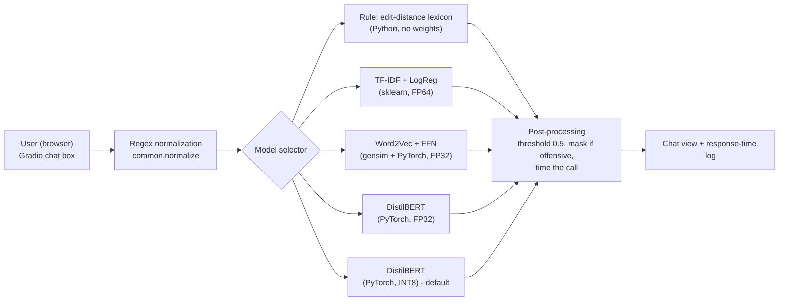

# Real-Time Chat Moderation (SWE015 Homework – Use Case 4)

A chat-like web app that labels every message **clean / offensive** live, masks offensive
messages, logs the response time of every message and lets you switch between five models.
The app runs the **quantized Transformer (DistilBERT, dynamic INT8)** by default and is meant for a CPU-only server.

- **Data:** TweetEval `offensive` subset (English; Barbieri et al., 2020), built on OLID / OffensEval 2019 (Zampieri et al., 2019). Loaded from the Hugging Face Hub.
- **Task metric:** macro-F1 (classes are imbalanced). **Latency:** ms per single message on CPU.
- **Results:** see `results.md` / `results.csv` (produced by `train.py` on my own run).

## Model ladder (all evaluated on the same held-out test set)

| Role | Model | Technique area |
|---|---|---|
| Rule baseline | edit-distance lexicon matcher | B |
| Classical baseline | TF-IDF + logistic regression | B |
| Neural network | Word2Vec (trained on the training messages) + feedforward net (SGD, backprop) | A |
| Transformer | DistilBERT fine-tuned for classification | C |
| Quantized Transformer | the same DistilBERT, dynamic INT8 | D |

Shared preprocessing (`common.normalize`): lowercase, remove URLs and @mentions, undo leetspeak (`b4d` -> `bad`), squeeze repeated letters (`fuuuck` -> `fuuck`).

## Architecture


Everything runs on the CPU of the machine that runs `python app.py` (Colab / local PC / Hugging Face Space).
Model files are downloaded from the Hugging Face Hub (not stored in this repo).

## Setup and run (fresh environment)

```bash
git clone <this-repo-url> && cd <repo-folder>
pip install -r requirements.txt
export ARTIFACTS_REPO=<your-hf-username>/<your-artifacts-repo>   # Windows PowerShell: $env:ARTIFACTS_REPO="..."
python app.py
```
Open the printed local URL (http://127.0.0.1:7860). Model weights: https://huggingface.co/<your-hf-username>/<your-artifacts-repo>

## Reproduce training and the results table

```bash
python train.py            # GPU recommended; writes artifacts/, results.csv, results.md, ...
```

## Files
`common.py` preprocessing, edit distance, model wrappers, benchmark · `train.py` training + evaluation · `app.py` the application · `colab_run.ipynb` runs everything on Google Colab.

## AI usage
See the AI Usage slide in the presentation (Claude was used for code drafting and debugging; I ran all experiments myself).
